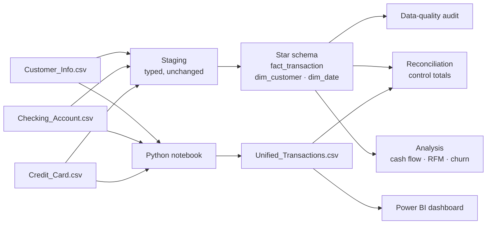
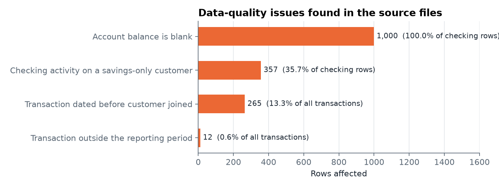
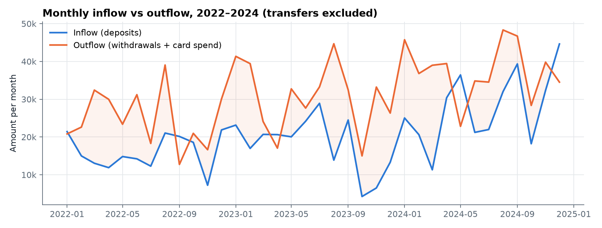
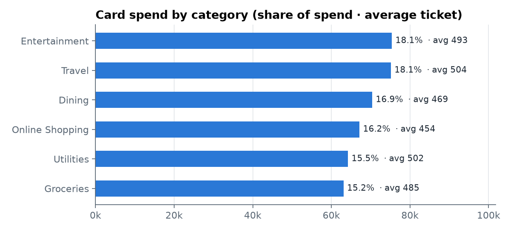
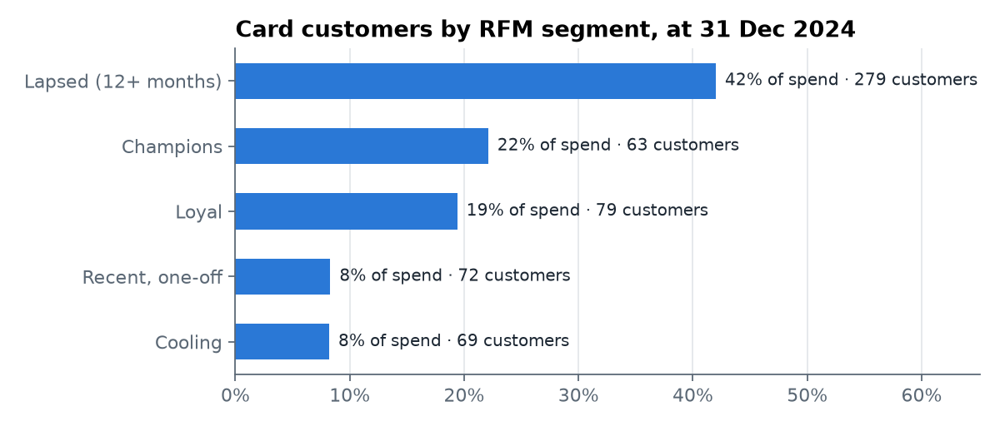

# Unified Customer Transactions

**A reconciliation-first data pipeline for banking transactions.** Three separate source files (checking accounts, credit cards and customer profiles) are combined into one trusted dataset. The pipeline audits the data for quality problems, proves through control totals that nothing was lost, and then answers business questions about cash flow, spending and customer activity.

| | |
|---|---|
| **Stack** | Python (pandas), SQL (DuckDB, PostgreSQL-style), Power BI |
| **Data** | 2,000 transactions from 1,000 customers, Jan 2022 – Jan 2025 |
| **Run it** | `python run_pipeline.py` rebuilds everything in this README in seconds |

> The dataset is synthetic: realistic generated records, not real customers. The methods are the same ones used on production banking data.

---

## The problem

Banks often hold checking and credit-card activity in separate systems, with customer details in a third. To answer simple questions like "how much money is coming in versus going out?" or "which customers have gone quiet?", the data has to be combined first, and combining it is where errors creep in:

- **Mismatched keys and IDs.** Both sources number their transactions from 1, so a naive merge creates collisions.
- **Mixed meanings in one column.** Deposits, withdrawals and card purchases all land in one "Amount" column, so adding them up produces a meaningless total.
- **Dirty records** that no one notices until a report is wrong.

This project treats those risks the way a finance operations team would: audit first, reconcile always, then analyse.

## Pipeline



| Step | File | What it does |
|---|---|---|
| Unify (Python) | `Unifying_Transactions.ipynb` | Cleans and merges the sources into `Unified_Transactions.csv`, the dashboard's data feed, with validation checks |
| 0. Staging | `sql/00_load_staging.sql` | Loads the raw CSVs into typed tables without changing them |
| 1. Model | `sql/01_star_schema.sql` | Builds `fact_transaction`, `dim_customer` and `dim_date`; adds flow direction, signed amounts and data-quality flags |
| 2. Audit | `sql/02_data_quality_audit.sql` | Runs seven checks and records rows affected and the action taken |
| 3. Reconcile | `sql/03_reconciliation.sql` | Compares row counts and amount totals across source, model and dashboard feed |
| 4–6. Analyse | `sql/04_…` to `sql/06_…` | Cash flow, card spending, RFM segmentation, inactivity and purchase gaps |
| Report | `run_pipeline.py`, `make_figures.py` | Runs everything, writes `outputs/*.csv` and `figures/*.png` |

### Key modelling decisions

- **Amounts keep their direction.** Every transaction has a `flow` (Inflow, Outflow, Transfer) and a `signed_amount`, so inflows and outflows are never added together.
- **Transfers are excluded from net flow.** The source doesn't record which way a transfer went, so guessing would misstate cash flow. They stay in the data and are reported separately.
- **Problems are flagged, never deleted.** Each row carries `dq_*` flags. The analysis view `v_fact_clean` excludes rows with impossible dates, but every excluded row can still be traced back to the source.
- **Unique transaction IDs.** Checking keeps IDs 1–1,000 and card transactions become 1,001–2,000, so every row has its own key.

---

## 1. Data-quality audit



| Check | Rows affected | Action |
|---|---|---|
| Account balance is blank | 1,000 (100% of checking rows) | Column dropped from the model |
| Checking activity on a savings-only customer | 357 (35.7% of checking rows) | Flagged for review; kept in analysis |
| Transaction dated before the customer joined | 265 (13.3% of all rows) | Flagged; excluded from analysis |
| Transaction outside the reporting period | 12 (0.6%) | Flagged; excluded from 2022–2024 figures |
| Duplicates · orphan transactions · zero or negative amounts | 0 | None found |

**What this means in practice:**
- One in eight transactions has a date that can't be right, because it happened before the customer opened their account. In a real bank that points to a migration error or a wrong join date, and it would go to the data owner before any report is published.
- More than a third of checking activity belongs to customers recorded as savings-only, so either the product field is out of date or the transactions are on the wrong customer.
- The balance column is completely empty, so no balance-based metric can be trusted from this extract.

## 2. Reconciliation

| Source | Source rows | Model rows | Dashboard rows | Source amount | Model amount | Dashboard amount | Status |
|---|---|---|---|---|---|---|---|
| Checking | 1,000 | 1,000 | 1,000 | 2,438,671 | 2,438,671 | 2,438,671 | ✅ Reconciled |
| Credit Card | 1,000 | 1,000 | 1,000 | 488,902 | 488,902 | 488,902 | ✅ Reconciled |

Every row and every dollar in the source files appears exactly once in the star schema and in the CSV that feeds Power BI. The reconciliation runs on every pipeline run, so a future change that drops or duplicates data is caught immediately.

**The original pipeline failed this check.** The first version of the merge renamed `Card_ID` when the column was actually `Card_Id`, so all 1,000 credit-card rows reached the dashboard with no transaction ID. Fixing that bug is what made this table balance.

## 3. Cash flow



| Year | Transactions | Inflow | Outflow | Net flow | Outflow growth |
|---|---|---|---|---|---|
| 2022 | 481 | 191,492 | 298,113 | −106,621 | — |
| 2023 | 571 | 216,951 | 367,267 | −150,316 | +23.2% |
| 2024 | 671 | 333,470 | 450,875 | −117,405 | +22.8% |

- **Outflows beat inflows in 31 of 36 months.** Withdrawals plus card spending consistently exceed deposits, so these accounts were net-negative every year.
- **2024 deposits jumped 54%** and narrowed the gap, while outflows kept growing at about 23% a year.
- **Part of the growth is customer growth.** New customers joined throughout the period, so activity per year rises naturally. A per-customer view is the next step.

Checking activity is spread evenly across channels: ATM 35.6%, branch 33.6% and online 30.8% of transactions, with similar average amounts (2,373–2,517).

## 4. Card spending and customer segments



Card spending is spread almost evenly. Entertainment and travel lead at 18.1% each, and groceries is lowest at 15.2%. Average tickets sit between 454 and 504, so no single category dominates.



Card customers are segmented on **recency, frequency and monetary value (RFM)**, measured at 31 December 2024:

| Segment | Customers | Avg. days since last purchase | Share of card spend |
|---|---|---|---|
| Lapsed (12+ months) | 279 | 663 | 42.0% |
| Champions | 63 | 100 | 22.1% |
| Loyal | 79 | 210 | 19.4% |
| Recent, one-off | 72 | 93 | 8.3% |
| Cooling | 69 | 268 | 8.2% |

- **42% of historical card spend came from customers who haven't used their card in over a year.** That's the clearest re-engagement opportunity.
- **63 "Champions" (11% of card users) produce 22% of spend.** They're the customers to protect.
- **Purchases are infrequent.** The median gap between a customer's card purchases is 256 days, so a customer who goes quiet for a quarter isn't yet a churn signal.

Card adoption is flat across income bands (54.7–57.3%) and spend per card user varies only from 660 to 778, so income is not what drives card usage in this data.

## 5. Customer activity

| Days since last activity (at 31 Dec 2024) | Customers | Share |
|---|---|---|
| 0–90 | 147 | 14.7% |
| 91–180 | 155 | 15.5% |
| 181–365 | 215 | 21.5% |
| Over a year | 387 | 38.7% |
| No valid activity (all transactions failed date checks) | 96 | 9.6% |

Almost half of customers (48%) show no valid activity in the last year. The last row ties back to the audit: 95 of those 96 customers have *only* transactions dated before they joined, so all their activity disappears once impossible dates are excluded.

---

## Power BI dashboard review

`Unified_Transactions.pbit` is built on the unified CSV. Reviewing its measures alongside this audit turned up three things to fix in the next version:

| Measure | Issue | Fix |
|---|---|---|
| `Total Amount` | Adds deposits, withdrawals and card spend together, so the headline figure has no financial meaning | Split into Inflow, Outflow and Net Flow using the `flow` logic from `01_star_schema.sql` |
| `Credit Utilization` | Divides by a `Credit Limit` column that is not in the data, so it always returns blank | Remove it, or source credit limits from the card system |
| Data source | Points to a file path on the original author's computer | Use a relative path or a parameter |

## Skills demonstrated

- **Data modelling:** star schema with fact and dimension tables, surrogate keys and a calendar dimension
- **Financial data controls:** source-to-target reconciliation with control totals, and data-quality rules with documented actions
- **SQL:** CTEs, window functions (`LAG`, `NTILE`, running totals, share-of-total), `FILTER` aggregates, date logic
- **Analysis:** cash-flow trends, category mix, RFM segmentation, inactivity analysis
- **Communication:** findings written for a business audience, with every number traceable to a query

## Run it

```bash
pip install -r requirements.txt
python run_pipeline.py          # builds the model, runs every check and analysis, writes outputs/ and figures/
jupyter notebook Unifying_Transactions.ipynb   # regenerates the Power BI feed
```

To open the dashboard, open `Unified_Transactions.pbit` in Power BI Desktop. On first load, go to **Transform data → Data source settings → Change Source** and select `Unified_Transactions.csv` from this folder.

## Files

```
unified-transactions/
├── Customer_Info.csv, Checking_Account.csv, Credit_Card.csv   # raw sources
├── Unifying_Transactions.ipynb      # Python merge → Unified_Transactions.csv
├── Unified_Transactions.csv         # dashboard feed
├── Unified_Transactions.pbit        # Power BI template
├── sql/                             # staging, star schema, audit, reconciliation, analysis
├── run_pipeline.py                  # runs all SQL in DuckDB, exports results
├── make_figures.py                  # charts for this README
├── outputs/                         # every report table as CSV
└── figures/                         # charts
```

## Next steps

- Report activity per active customer to separate real growth from customer growth
- Send the data-quality findings back to the data owners and add a target date to resolve each one
- Rebuild the Power BI measures on the star schema so the dashboard shows inflow, outflow and net flow
- Schedule the pipeline (for example with Airflow) and alert when reconciliation breaks
